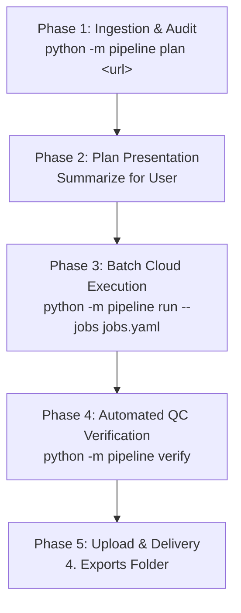

# AGENTS.md — Autonomous Video Production Agent Playbook

> **Target Audience:** Any AI coding agent (Antigravity, Claude Code, Cursor, Windsurf, Codex, etc.) cloned into this repository to execute short-form vertical video promo localization and editing assignments.

---

## 1. Primary Directive

When the user shares a client brief or task message containing:
* Google Drive links (e.g. `1. Promo`, `2. VO logo cta`, `0 - Shows`),
* Promo codes (e.g. `FDED572FR`, `FDEA458JP`),
* Show names and target languages (French, Japanese, German, Spanish, etc.),
* Custom notes (logo placement, watermark removal, CTA requirements),

**DO NOT start reinventing video editing scripts or manually editing files from scratch.**
Follow the deterministic 5-phase protocol below.

---

## 2. Domain Knowledge Base

### What is a Vertical Drama Promo?
These are 30-second to 10-minute 9:16 vertical video advertisements created for short-form drama streaming apps (Free Drama, ReelShort, DramaBox, ShortMax) to run on TikTok, Meta Reels, and YouTube Shorts.

### Anatomy of Every Promo:
```
[ 0.0s – ~30s: Hook / VO ]  ──►  [ Middle: Drama Body ]  ──►  [ End: Outro CTA ]
• Localized Voiceover (FR/JP)     • High-tension cliffhanger    • Pre-made app install card
• Styled Subtitles (.srt/.ass)    • Localized Show Logo (.mov)  • "Download Free Drama"
• Localized Show Logo (.mov)      • Header watermark masked     • Synchronized audio outro
• Original English Title masked
```

### The 3 Promo Archetypes:

| Archetype | Indicators | Required Recipe | Action Required |
|---|---|---|---|
| **Archetype A:<br>VO Hook Promo** | Has a matching `_dubbed.mp4` / `_VO.mp4` and `.docx` script in `2. VO logo cta`. | `recipes.vo_promo` | 1. Replace hook audio with localized VO.<br>2. Generate timed `.srt` from script.<br>3. Mask English title watermark.<br>4. Overlay translated `.mov` logo at top.<br>5. Append localized CTA outro. |
| **Archetype B:<br>Dialogue / Cliffhanger** | No separate VO or `.docx` script. Video is pure continuous drama scenes. | `recipes.cliffhanger` | 1. Keep native episode dialogue.<br>2. Mask English title watermark.<br>3. Overlay translated `.mov` logo at top.<br>4. Append localized CTA outro.<br>*(No subtitle or audio swap needed)*. |
| **Archetype C:<br>Clean Master Re-Sync** | Client provides raw full episodes in `0 - Shows` and asks to eliminate hardcoded watermarks or burnt-in foreign subs across the entire video. | `recipes.clean_sync` | 1. Extract audio slices from promo.<br>2. Run waveform cross-correlation (`scipy.signal.correlate`) against full master episodes.<br>3. Re-cut promo using 100% clean footage.<br>4. Apply logo, subtitles, and CTA. |

---

## 3. The 5-Phase Execution Protocol



### Phase 1: Ingestion & Audit
Run the automated planner tool:
```bash
python -m pipeline plan "<GOOGLE_DRIVE_FOLDER_URL>"
```
Or for local folders:
```bash
python -m pipeline plan --local-dir "./inputs"
```
The planner automatically:
1. Enumerates all reference promo videos in `1. Promo`.
2. Scans `2. VO logo cta` for matching VO files, scripts (`.docx`), logos (`.mov`), and CTAs (`.mp4`).
3. Categorizes each promo into Archetype A or Archetype B.
4. Identifies language mismatches or junk files (e.g. German files left in a French folder).
5. Emits `jobs.yaml` with pre-filled recipes.

### Phase 2: Plan Presentation
Present the plan clearly to the user:
- Show count, languages, and breakdown of Archetype A (with VO) vs Archetype B (cliffhangers).
- Flag any missing assets or anomalies discovered.
- State estimated render time (typically ~35–45 minutes for 10 videos in Modal cloud).
- Ask for user confirmation before launching cloud compute.

### Phase 3: Cloud / Local Execution
Execute the pipeline:
```bash
# Cloud-first via Modal (Recommended: fast, parallelized across serverless containers)
python -m pipeline run --jobs jobs.yaml --backend modal

# Or local fallback (if Modal token is not set)
python -m pipeline run --jobs jobs.yaml --backend local
```

### Phase 4: Automated QC Verification
Inspect rendered outputs:
```bash
python -m pipeline verify --jobs jobs.yaml
```
- Extracts check frames at 2s, 15s, 50% runtime, and end frame.
- Verifies resolution is 1080×1920 (or 720×1280), audio sample rate is 48 kHz stereo, and duration matches expectations.
- Ensures the top logo is legible and subtitles are not cut off.

### Phase 5: Delivery
Once verified:
1. Upload finished `.mp4` files directly into Google Drive's `4. Exports` folder.
2. Follow the client's naming convention:
   `<YourName>_<PhoneNumber>_<PromoCode>.mp4` (or exact `<PromoCode>.mp4` if instructed).
3. Provide the user with a summary table and direct file links.

---

## 4. Key Rules for Agents

1. **Never Chain Commands with `&&` on Windows:** Use `;` instead in PowerShell.
2. **Quote Paths with Spaces:** Always prepend `&` in PowerShell when paths have spaces (e.g. `& "C:\Program Files\..."`).
3. **Safe Mobile Areas:** Keep all primary text and subtitles within vertical safe areas ($Y: 400\text{px} - 1500\text{px}$). Top $200\text{px}$ is for logo and header; bottom $300\text{px}$ is reserved for TikTok/Reels captions and UI.
4. **Transparent Logos:** The show logos in `2. VO logo cta` are `.mov` files with an alpha channel. Always overlay using alpha blending (`overlay=format=auto`).
5. **Ignore Unrelated Foreign Files:** Always verify language codes (`FR` = French, `JP` = Japanese, `GR`/`DE` = German, `ES` = Spanish). If a file from another language appears in the folder (e.g. `_de_` in a French project), ignore it and report it in the audit.
